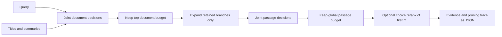

# Decision Tree Retrieval

Retrieve evidence by navigating a document hierarchy. One shared-context decision scores document descriptions; code expands only the selected documents, scores their passages together, and optionally reranks a short passage list. This exposes which branches were pruned and why. No vector shortlist is constructed at query time.

This is an independent, two-level implementation of the navigation pattern in [Retriever-Free Retrieval](https://arxiv.org/abs/2610.35868). It includes an optional Jev HTTP adapter and a clearly labelled lexical stand-in so the full pipeline runs offline. The sample corpus is fictional object-storage documentation.

## Run

Python 3.10+ is sufficient; there are no third-party runtime or test dependencies.

```powershell
python -B -m decision_tree
python -B -m decision_tree "How long can I restore a deleted object?" --documents 2 --passages 3 --rerank 3
python -B -m unittest discover -s tests -v
```

For live decisions, set your own key in the process environment and opt in:

```powershell
$env:TYPESAFE_API_KEY = "replace-with-your-key"
python -B -m decision_tree --judge jev --model jev-1.13.0 --rerank 3
```

The adapter targets the documented TypeSafe `POST /v1/systemone` API, `noul` questions and `choice` probability distributions. `jev-1.13.0` is the explicit default, matching the studied model family; use `--model` if your account exposes a different version. Live model availability and responses have not been tested here. Live runs incur provider usage. The adapter uses the fixed HTTPS service endpoint, rejects redirects and never writes the key.

## How it works



Document scoring sees titles and summaries, not passage bodies. Passage scoring sees only retained branches. Binary relevance values do not need to sum to one. Choice probabilities do, and reorder only the first `m` retained passages; the remaining tail keeps its binary order. Here `m` is the smaller of `--rerank` and the retained passage count; fewer than two skips choice entirely. Ties preserve corpus order. `--weight-by-document` explicitly multiplies passage scores by parent scores before ranking. The returned trace contains all evaluated IDs and scores.

The JSON corpus is an array of documents with globally unique `id`, `title`, `summary`, and a nonempty `passages` array of `{ "id": "...", "text": "..." }`. Supply another file using `--corpus path/to/corpus.json`. Budget flags limit expansion and final evidence count. All output goes to stdout; the program creates no data files.

## Code map

| File | Responsibility and connections |
|---|---|
| `decision_tree/__init__.py` | Package declaration. |
| `decision_tree/models.py` | Immutable document, passage and candidate records; validates IDs and loads bounded JSON input. |
| `decision_tree/judges.py` | Shared judge interface by convention, lexical stand-in and live Jev adapter; validates answer keys, types, finite probabilities and choice normalization. |
| `decision_tree/navigate.py` | Applies document/passage budgets, irreversible branch pruning, optional parent weighting, partial reranking and trace construction. |
| `decision_tree/__main__.py` | CLI entry point connecting corpus, judge and navigator; prints JSON or exits with an error. |
| `examples/corpus.json` | Three fictional documents and six passages for an offline run. |
| `tests/test_navigation.py` | Independent scripted-score navigation tests and mocked HTTP request/response contract tests. |
| `requirements.txt` | Documents the standard-library-only environment. |
| `.gitignore` | Excludes caches, environments, generated artifacts and local secrets. |

## Limits and validation

- The lexical judge is term overlap, not a trained decision model; its values are uncalibrated heuristics. `quality_evidence: false` is emitted because this project does not evaluate quality against labelled data, including when live mode is selected.
- Tests exercise pruning, joint requests, budgets, weighting, reranking and malformed responses without making model calls. HTTP tests replace the transport; they establish request shape and error behavior, not provider compatibility or retrieval quality.
- This example supports a document-to-passage hierarchy. It does not construct embedding clusters, train a decision model, implement arbitrary-depth traversal, reproduce large-corpus benchmarks or generate an answer.
- Each stage is one bounded request. Oversized stages fail explicitly rather than silently truncating candidates or introducing another retriever. Corpus input is limited to 4 MiB, live requests to 256 KiB and responses to 1 MiB; these are example safeguards, not model context limits.
- Early pruning is irreversible. Tune budgets and evaluate on representative queries before relying on retrieved evidence. Treating corpus content as data in questions is not a complete prompt-injection defense.

## References

- [Navigation method](https://arxiv.org/abs/2610.35868)
- [TypeSafe Noul API](https://docs.typesafe.ai/primitives/noul)
- [TypeSafe Choice API](https://docs.typesafe.ai/primitives/choice)
- [TypeSafe API overview](https://docs.typesafe.ai/introduction)
